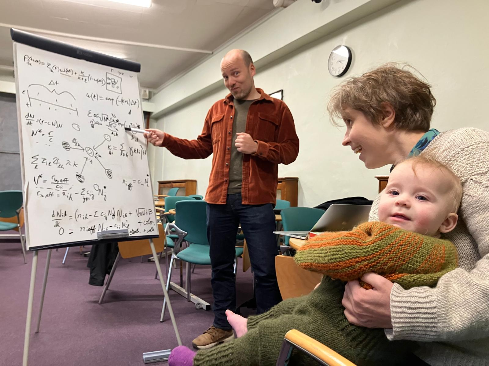

Visited the University of Oxford to work with
[Aura Raulo](https://www.biology.ox.ac.uk/people/aura-raulo) and [Guilhem Sommeria-Klein](https://team.inria.fr/pleiade/guilhem-sommeria-klein)
on a metacommunity framework for socially transmitted microbiomes

